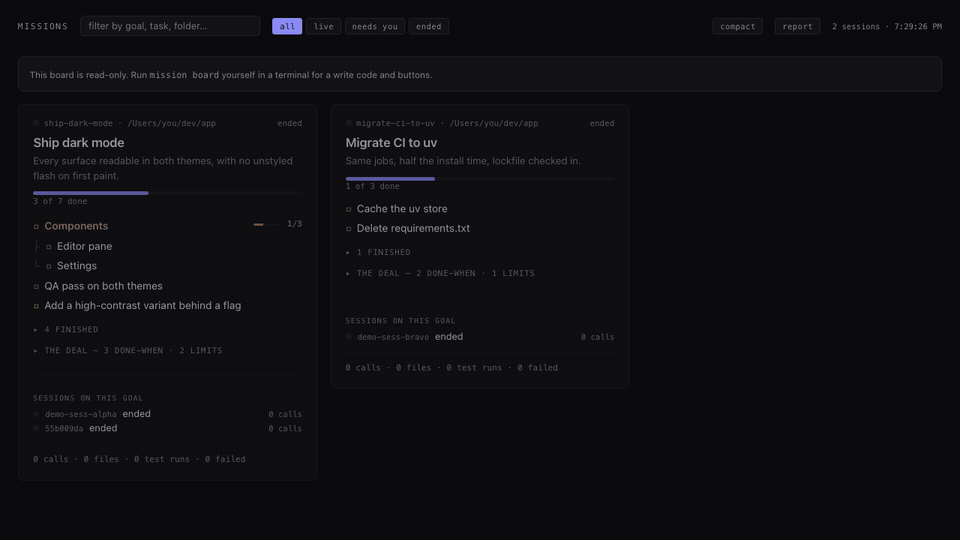

# mission

**Goal provenance for coding-agent sessions: every goal change records who made
it, and every completion claim is checked against the disk before you rule on
it — which is evidence, not prevention, and not proof the work is right.**

[](https://github.com/jlee844/agent-mission/actions/workflows/tests.yml)
[](pyproject.toml)
[](pyproject.toml)
[](LICENSE)

`mission` is a zero-dependency Python CLI plus a local web board for Claude
Code and Codex sessions, built on three write authorities:

- **protected** objectives — human-authored
- **proposed** work — agent-suggested, human-accepted
- **observable** state — evidence the agent records freely

A claim naming nothing is unchecked, never counted as backed. Integration:
Claude Code hooks, statusline, deny rules, the board — [architecture below the
fold](#architecture). Reproduce: `pip install -e ".[dev]" && python -m pytest -q`.

Why it exists: 800 tool calls into a session, the summary is written by the
thing being summarised, and nothing answers *what was this for — is it done?*

```bash
pip install git+https://github.com/jlee844/agent-mission
mission setup      # slash command, deny rules, statusline, re-anchor hook, attention hook, claim hook, pane
```

## Your whole job

| when | you do |
|---|---|
| once | answer the interview — `/mission init` asks what done looks like, one question at a time; your agent transcribes, never authors |
| per login | paste the write code the board prints in your terminal — the agent never sees it |
| when the strip lights | click **accept** on a proposed subgoal, **confirm** on a tick the disk corroborated |

Everything else runs itself. The statusline keeps the goal one glance away:
```
Ship list sharing · 2/5 · detour: chasing a flaky test · 3 proposals waiting
```

The mission re-anchors the agent after compaction; completion claims are checked
against the disk **in the turn they are made**; finished items arrive as
suggestions with the verdict attached — *"the named file changed since you agreed"* — and
one line lands in the conversation only when something *newly* needs you.
**Silence means on track.**

**The board is where you click.** `mission board` — every goal on one page: the
plan as a tree, and what each session **actually did** (calls, files, tests —
read from the transcript, not reported by the agent). A strip on top answers
*is anything waiting on me*.



Everything below the line is for the agent, or for scripting.
**Humans use the board; agents use the CLI.**

### Three levels of authority

| level | fields | who writes |
|---|---|---|
| 🔒 **protected** | objective, success criteria, constraints, non-goals | **you only** |
| 🟡 **proposed** | checklist, strategy | agent suggests, you accept |
| 🟢 **observable** | decisions, evidence, notes, detours | agent records freely |

Enforced in the store, at the terminal, and by Claude Code's deny rules —
[SECURITY.md](docs/SECURITY.md) says how, and what that does *not* cover.

### Why not just a TODO.md?

- **Every plan file is agent-writable** — "done" is self-reported by the thing
  being graded. Here, ticking is yours.
- **A plan file stops at a file nothing reads back.** This one comes to you.
- **Keep your planner:** `import` lands writing-plans / GSD / Kiro markdown as
  proposals, and diffs on re-import.

---

# Agent & scripting reference

## Architecture

The whole design in one picture — write authority flows down, and nothing
moves the counter except a human ruling on evidence:

```
                 human writes
                      ▼
        ┌─ PROTECTED ─────────────────┐
        │ objective · criteria        │
        │ constraints · non-goals     │
        └─────────────┬───────────────┘
                agent proposes
                      ▼
        ┌─ PROPOSED ──────────────────┐
        │ checklist · strategy        │      inert until accepted
        └─────────────┬───────────────┘
                 human accepts
                      ▼
        ┌─ OBSERVABLE ────────────────┐
        │ evidence · decisions        │      agent records freely
        │ detours · claims-done       │
        └─────────────┬───────────────┘
               disk corroborates
                      ▼
        ┌─ TICK ──────────────────────┐
        │ human confirms · by=human   │      one click, pre-evidenced
        └─────────────────────────────┘
```

Integration is one line: Claude Code and Codex hooks → append-only event log
(`~/.agent-mission/`) → statusline · signal · board · CLI. State is a fold
over the log, so *why does it say this* is always answerable from history.

## Setup

`setup` finishes the job — it backs up your settings, appends to hooks instead
of replacing them, wraps an existing statusline keeping your original verbatim,
and refuses to touch anything unless a person is at the keyboard. Re-running it
is always the complete fix. `mission setup --check` shows what is live.
(Contributing? `git clone` and `pip install -e ".[dev]"` instead of the
one-liner.)

Opt-in, never installed by default: `--auto-board` starts a writable board
from your shell rc at login (one code paste per day, buttons thereafter);
`--notify` adds an OS notification when a proposal lands (edge-triggered, max
one per 10 minutes).

### Install from Codex first, then connect Claude Code

The board belongs to the local `~/.agent-mission` store, not to either coding
assistant. On the same Mac and user account, Codex and Claude Code can attach
to and update the same goals in either order. Set up each client once; the
trust and sandbox steps are left to the person on purpose: the tool never
writes them, and an agent should not.

1. Install the CLI, then run Codex setup in a **person-operated terminal**:

   ```bash
   pip install git+https://github.com/jlee844/agent-mission
   mission setup --codex
   ```

   The installer backs up and writes `~/.codex/hooks.json` plus a mission
   protocol block in `~/.codex/AGENTS.md`. It is idempotent and preserves
   unrelated hooks. The file uses Codex's required top-level `hooks` object.

2. Finish the two security steps it prints:
   - In Codex, open `/hooks` and review/trust the two mission hooks. Codex does
     not run untrusted hooks.
   - Add the exact `[sandbox_workspace_write]` stanza printed by the installer
     to `~/.codex/config.toml`. It grants the local agent access to the board
     store under `~/.agent-mission`; the installer deliberately does not edit
     this security setting. Preserve any existing `writable_roots` entries.

3. Restart Codex and verify the setup. If the board is new, the **person**
   creates its first goal from the project directory in a terminal with
   `mission init`; then attach Codex to that goal. Otherwise, attach to an
   existing mission:

   ```bash
   mission setup --codex --check
   mission missions
   mission attach <goal-name>
   mission whereami --full
   mission queue --on <goal-name>
   ```

   If no goal fits, the person creates/approves one first; agents must not
   invent or repurpose goals. The CLI and board are shared, so the goal created
   during this Codex-first workflow is immediately available to Claude Code.

4. Connect Claude Code later from the same machine/account:

   ```bash
   mission setup
   ```

   In Claude Code, run `/mission`, then attach to the same goal (or use
   `mission attach <goal-name>`). Both clients now report sessions, evidence,
   proposals, and claims to the same board. No export/import or migration is
   needed. If the clients use different machines or `AGENT_MISSION_HOME`
   values, they are not sharing the same local store automatically.

5. If `mission setup --codex --check` reports `hooks.json invalid`, rerun
   `mission setup --codex` from the person's terminal; the installer can back
   up and migrate the older flat event format. Then revisit `/hooks` and trust
   the updated hook definitions again if Codex prompts.

## Commands

| command | what it does |
|---|---|
| `init` | interview and write the mission (`--from-file`, `--force --discard-plan`) |
| `show` | the goal, the plan, measured activity (`--all` includes finished) |
| `whereami` | one line for a statusline (`--full` = the re-anchor + protocol payload) |
| `pending` | what awaits your accept, and the command that clears it |
| `add` / `propose` | add agreed work / suggest it (inert until accepted; `--under <id>`) |
| `accept` / `done` / `remove` | rule on proposals, tick work, drop subtrees (`--pending`, `--under`) |
| `set` | change a protected field, keeping the plan and the history |
| `why <field>` | when it changed, to what, and who typed it |
| `attach` / `missions` | point this session at a goal / list every goal |
| `archive` / `migrate` | take a finished goal off the board (`--undo`) / lift old stores |
| `detour` / `return` | declare a side quest; return replays the goal |
| `observe` | record evidence, a decision, or a note |
| `import <file>` / `delegate <id>` | land an external plan as proposals / spin one item into a subagent session |
| `signal` | one line if something newly awaits you; silent otherwise (for hooks) |
| `take` | ask the board for the next item and take it — no human needed to say what |
| `release <id>` | hand an item back without claiming it is finished |
| `finding <id> <text>` | say an accepted item is NOT done, and why; clears its claim and re-queues it |
| `dispatch` | what to hand out, and the message to hand over — prints a plan; `--spawn` starts the sessions, and only you can |
| `queue` | the four lanes: ready · in progress · in review · waiting on you |
| `watch` | open a READ-ONLY board — no write code, no buttons; a session may start this one |
| `audit` | items agreed long ago that nobody ever touched — the brief for checking whether they are already built |
| `verify` | the brief a verification session reads — claims, artifacts, the disk's verdict |
| `checked <id> <text>` | a second session re-derived a claim and agrees (an opinion, not evidence) |
| `claims-done <id> <text>` | suggest an accepted item is finished; the board attaches the disk's verdict |
| `claims` | verify recent completion claims against the disk; silent when backed (for hooks) |
| `sharpen` | which criteria name no file, so finishing them can't be checked (`--propose`) |
| `doctor` | what is wrong with the missions themselves, not the install |
| `snapshot` | every goal as JSON, for a pane or another surface; read-only |
| `guards` | what the guardrails have refused: the evidence they earn their keep |
| `skip-dir` | this folder does not belong on the board — stop asking |
| `needs-human` | a verifier read the claim and cannot decide, and says why |
| `verifier` | this session is the goal's standing verifier |
| `board` | the shared board; at a tty it is writable (`--stop`) |
| `passcode` | set the board's write code yourself, so it survives restarts (`--clear`) |
| `setup` / `help <cmd>` / `version` | install; usage without running; the build + every live command |
| `setup --codex` | the same hooks and protocol for Codex (GPT) threads; prints the one sandbox line Codex needs, never edits it |

## Addressing

**Names route, sessions speak, directories inform.** `--on <name>` is the
explicit address and the only one worth typing in a script; a session that has
been attached to a goal resolves without it, and the process's directory never
routes. It reaches both storage layouts:

```bash
mission attach career                      # this session serves that goal
mission set objective "Ship invites too" --on career
mission accept --pending --on career
```

The session id in the environment says *who is writing*, never what is meant.
The working directory says neither and is not consulted — a cwd router existed
once, misrouted a real write, and died ([DESIGN.md](docs/DESIGN.md) has the
post-mortem). When nothing names a goal, `mission` refuses and lists yours,
each with a paste-ready command.

## The board, precisely

**One board per store.** Starting a second finds the first. It lives at
`127.0.0.1:8976` and returns there after restarts; `~/.agent-mission/board.html`
is a bookmark that never goes stale. Writes are gated by a code printed only
to the terminal of the person who started it — the minted code is kept in
memory, never written to disk and never served; wrong guesses lock out. (A
passcode you SET is different: it is stored as a salted hash in
`~/.agent-mission/passcode.json`, which the agent can read and rewrite, so the
board prints the date it was last written.) Colour on the board means one thing:
the warm accent is *waiting on you*. The muted hues on the tree are structure
— rows under one subgoal share their domain's colour, assigned by a keyword
table, not a classifier.

## Limitations

- **Outside Claude Code you must name the goal** — `--on` autocompletes
  nothing, which is why `init` insists on a short memorable name.
- **Progress is measured or marked, never inferred.** No drift detection, on
  purpose — [DESIGN.md](docs/DESIGN.md) has the five dead detectors.
- **The event log is a plain file.** An agent with shell access can forge an
  append. The guarantee is no *silent* rewrite through this tool's interfaces,
  not tamper-proofness.
- **macOS and Linux. Windows is untested.** The process walk shells out to
  `ps`, liveness reads `/tmp/cc-socks`, and the log lock uses `fcntl.flock`
  with an `msvcrt` branch nobody has run. CI has run on Ubuntu; macOS jobs
  are configured and have not run yet.
- **The tty gate is a speed bump, not a boundary.** Four of five attack
  rounds got through. The last needs no `script`, and the event it writes is
  marked only because of a stamp that does not share the gate's detector —
  the first version of which missed it entirely. [SECURITY.md](docs/SECURITY.md) says what each layer does
  and does not buy.
- **Known rough edges**, named because a stranger meets the first two early:
  - Liveness: with no goals yet there is no heartbeat to read, so the board
    falls back to recent file times and labels those rows "possibly live —
    guessed". It is the only inferred thing in the tool and it says so.
  - The board's JavaScript syntax check skips without `node` on PATH.
  - Leases last 90 minutes. Re-taking your own item renews it; a session
    that stops lets it lapse.
  - The board's JavaScript syntax test needs `node` on PATH. CI runners have
    it; a local run without it fails rather than skips.
- **Not on PyPI.** Install from source.

## Docs

- [FINDINGS.md](FINDINGS.md) — what 56 days of real use measured, including where the design failed
- [DESIGN.md](docs/DESIGN.md) — why it is shaped this way; the five dead drift detectors
- [SECURITY.md](docs/SECURITY.md) — what is enforced, and the honest limits
- [adversarial-testing.md](docs/adversarial-testing.md) — five rounds of attacks on the authority model, four of which got through, and what each one bought
- [evidence.md](docs/evidence.md) — every unusual claim, mapped to the artifact that substantiates it

## Part of a set

Four small tools that read what an AI coding session actually did, rather
than what it said it did.

| | |
|---|---|
| **mission** *(you are here)* | the goal, beside the work |
| [**receipt**](https://github.com/jlee844/receipt) | what a session did, what it cost, which claims are backed |
| [**blindspot**](https://github.com/jlee844/blindspot) | which changed lines a test would actually catch a bug in |
| [**transcript-audit**](https://github.com/jlee844/transcript-audit) | profile a transcript corpus before computing anything over it |

MIT.
